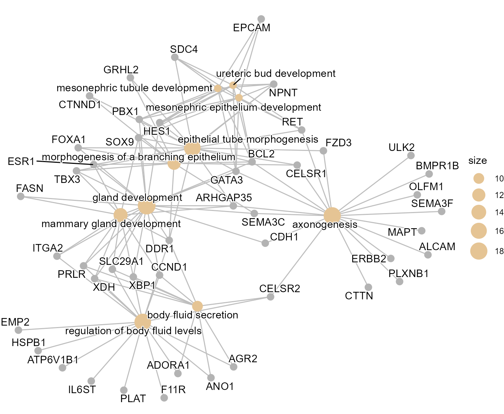

# Breast cancer

## Breast cancer

This vignette demonstrates the SpatialCopyInference workflow using a
human breast cancer dataset as an example.

First, packages necessary for this vignette are loaded.

``` r

# Load SpatialCopyInference
library(SpatialCopyInference)

# Load additional packages used in this workflow
library(ggplot2)
library(patchwork)
library(dplyr)
```

## Data import

This workflow uses a Xenium human breast cancer dataset from 10x
Genomics: FFPE Human Breast Cancer with 5K Human Pan Tissue and Pathways
Panel plus 100 Custom Genes.

Users wishing to reproduce this analysis should first download the
Xenium output files from:

<https://www.10xgenomics.com/datasets/xenium-prime-ffpe-human-breast-cancer>

``` r

# Path to Xenium output directory
data_dir <- "path/to/Xenium_outputs/outs"
```

``` r

# Import Xenium data
xenium.obj <- import_xenium(data_dir, annotation_file = NULL)

# Dataset dimensions
dim(xenium.obj)
#> [1]   5101 699110
```

## Quality control

Cell quality is assessed using the distributions of detected genes
(`nFeature_Xenium`) and transcript counts (`nCount_Xenium`).

Low quality cells are removed using
[`filter_cells()`](../reference/filter_cells.md).

``` r

# Dataset dimensions before filtering
dim(xenium.obj)
#> [1]   5101 699110

# Filter low quality cells
xenium.obj <- filter_cells(xenium.obj)

# Dataset dimensions after filtering
dim(xenium.obj)
#> [1]   5101 699110
```

## Gene filtering

Lowly expressed genes are filtered using
[`filter_genes()`](../reference/filter_genes.md) prior to downstream
analyses.

``` r

# Number of genes before filtering
nrow(xenium.obj)
#> [1] 5101

# Filter lowly expressed genes
xenium.obj <- filter_genes(xenium.obj,
                              min_cells = 50,
                              min_counts = 50)

# Number of genes after filtering
nrow(xenium.obj)
#> [1] 5091

# Display removed genes
head(xenium.obj@misc$removed_genes, 20)
#>  [1] "CYP2A6"                  "EIF1AY"                 
#>  [3] "F2"                      "HPV16-E6"               
#>  [5] "HPV16-E7"                "HPV18-E6"               
#>  [7] "Human-CTNNB1-S33C-ALT:G" "Human-PTEN-G129E-WT:A"  
#>  [9] "SRY"                     "TBL1Y"
```

## Normalisation

Normalisation is performed using
[`normalise_data()`](../reference/normalise_data.md), which applies
[`Seurat::NormalizeData()`](https://satijalab.org/seurat/reference/NormalizeData.html)
with the “LogNormalize” method and converts the resulting values to log2
scale.

``` r

# Perform normalisation
xenium.obj <- normalise_data(xenium.obj)

# Example log2-normalised expression values for selected genes
xenium.obj@assays$Xenium$data[c("CCNE1", "MKI67", "TP53"), 1:5]
#> 3 x 5 sparse Matrix of class "dgCMatrix"
#>       aaaaaohf-1 aaaabkoj-1 aaaafefl-1 aaaahfjm-1 aaaahjao-1
#> CCNE1          .          .   .                 .          .
#> MKI67          .          .   5.238967          .          .
#> TP53           .          .   .                 .          .
```

## Chromosome arm means

Chromosome arm means for each cell are computed using
[`compute_arm_means()`](../reference/compute_arm_means.md).

``` r

# Compute arm means 
arm_means_matrix <- compute_arm_means(xenium.obj,
                                      min_genes_per_arm = 5)

# Show values for a subset chromosome arms and cells
arm_means_matrix[1:5, 1:5]
#>        aaaaaohf-1 aaaabkoj-1 aaaafefl-1 aaaahfjm-1 aaaahjao-1
#> chr1_p  0.2959307  0.3585170  0.3141599  0.3021565  0.1381910
#> chr1_q  0.5183918  0.5661828  0.7094592  0.5161949  0.2677993
#> chr2_p  0.4412000  0.4945979  0.5379027  0.5087038  0.1041442
#> chr2_q  0.3848401  0.3380283  0.2784934  0.3110749  0.1874595
#> chr3_p  0.3697962  0.5058899  0.4718819  0.4492931  0.3033969
```

## Log ratio profiles

Here, chromosome arm log ratios are computed using the global mean of
all cells with
[`compute_arm_ratios()`](../reference/compute_arm_ratios.md).

``` r

# Compute chromosome arm ratios using global mean as reference
arm_ratios <- compute_arm_ratios(arm_means_matrix, xenium.obj)

# Show ratios for a subset chromosome arms and cells
arm_ratios[1:5, 1:5]
#>        aaaaaohf-1 aaaabkoj-1 aaaafefl-1 aaaahfjm-1 aaaahjao-1
#> chr1_p  0.2065435  0.2691297  0.2247726  0.2127692 0.04880377
#> chr1_q  0.4026102  0.4504012  0.5936776  0.4004134 0.15201772
#> chr2_p  0.3500320  0.4034300  0.4467348  0.4175359 0.01297622
#> chr2_q  0.2959983  0.2491865  0.1896517  0.2222332 0.09861773
#> chr3_p  0.2770631  0.4131569  0.3791488  0.3565600 0.21066380
```

## Spatial clustering

Here, BANKSY is applied to chromosome arm log ratio profiles generated
by [`compute_arm_ratios()`](../reference/compute_arm_ratios.md) using
[`compute_spatial_clusters()`](../reference/compute_spatial_clusters.md).

``` r

# BANKSY clustering using lambda = 0.8
BANKSY.obj <- compute_spatial_clusters(
          arm_ratios = arm_ratios,
          xenium.obj = xenium.obj,
          lambda = 0.8,
          resolution = c(0.05)
          )
```

## Cluster visualisation

The resulting clusters are visualised using
[`plot_cluster_heatmaps()`](../reference/plot_cluster_heatmaps.md). In
this breast cancer dataset, three distinct SCNA populations were
identified. Cluster 3 showed the most extensive inferred chromosome
arm-level SCNA gains, including at 1q, 8q and 17q, which are recurrently
gained in breast cancer. Clusters 1 and 2 remained largely copy number
neutral, with Cluster 1 surrounding the Cluster 3 regions and Cluster 2
occupying more distant tissue regions.

``` r

# Plot cluster heatmap for lambda = 0.8 and resolution = 0.05
plot_cluster_heatmaps(
    BANKSY.obj,
    resolutions = c(0.05)
    )
#> $res_0.05
```

 Cluster
assignments are transferred back to the Xenium object using
[`add_banksy_clusters()`](../reference/add_banksy_clusters.md).

``` r

# Add arm clusters of desired lambda and resolution back to main Xenium object
xenium.obj <- add_banksy_clusters(xenium.obj,
              BANKSY.obj,
              resolution = 0.05)
```

Spatial cluster assignments are visualised using
[`plot_spatial_clusters()`](../reference/plot_spatial_clusters.md).
Consistent with the inferred SCNA profiles, Cluster 3 was predominantly
localised to tumour regions within the tissue section, whereas Clusters
1 and 2 were primarily associated with surrounding tissue compartments.

``` r

# Custom colour pallete
col_pal_BANKSY <- c("#8CD17D","#F28E2B","#4E79A7")

# Plot spatial clusters
plots <- plot_spatial_clusters(
    xenium.obj, 
    cluster_palette = col_pal_BANKSY
    )

# Plot one image with all spatial clusters
plots$spatial_clusters_plot
```


``` r


# Plot each spatial cluster separately
plots$spatial_clusters_plot_facets
```


## Cluster comparison

To characterise the biological differences between SCNA-defined
populations, differential expression and Gene Ontology enrichment
analyses were performed.

Cluster 3 (tumour-associated) and Cluster 2 (non-malignant) are
compared.

``` r

# Compare Cluster 3 vs 2
cluster3v2 <- compare_spatial_clusters(
              xenium.obj,
              ident_1 = "3",
              ident_2 = "2")

# Differentially expressed genes
head(cluster3v2$de)
#>           p_val avg_log2FC pct.1 pct.2 p_val_adj
#> XBP1          0  1.8624819 0.803 0.053         0
#> RAB11FIP1     0  1.1853150 0.772 0.047         0
#> CA12          0  1.9344039 0.672 0.019         0
#> H3F3B         0 -0.1647394 0.746 0.096         0
#> SLC9A3R1      0  1.0086283 0.605 0.020         0
#> HSPB1         0  0.5936562 0.589 0.030         0

# GO enrichment dot plot 
cluster3v2$go_dotplot
```


``` r

# GO enrichment cnet plot
cluster3v2$go_cnetplot
```



## Summary

This vignette demonstrated the SpatialCopyInference workflow using a
Xenium breast cancer dataset. Three distinct SCNA populations were
identified, including a tumour-associated cluster characterised by gains
of chromosome arms 1q, 8q and 17q, which are frequently amplified in
breast cancer.
