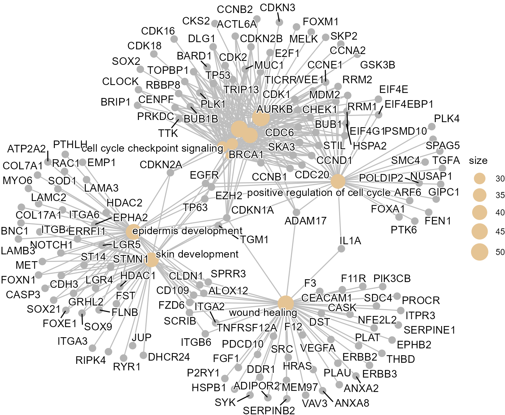
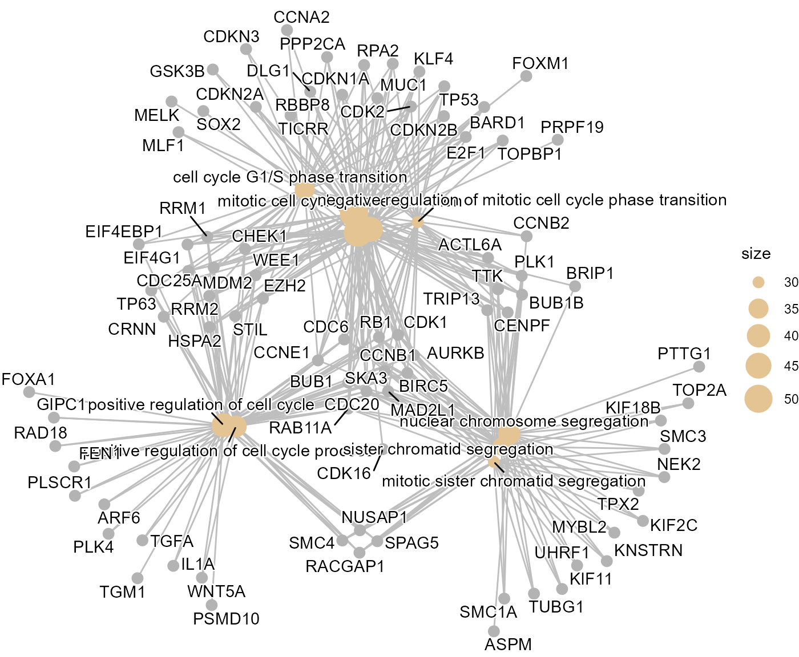

# Cervical cancer

## Cervical cancer

This vignette demonstrates the SpatialCopyInference workflow using a
human cervical cancer dataset as an example.

First, packages necessary for this vignette are loaded.

``` r

# Load SpatialCopyInference
library(SpatialCopyInference)

# Load additional packages used in this workflow
library(ggplot2)
library(patchwork)
library(dplyr)
```

## Data import

This workflow uses a Xenium human cervical cancer dataset from 10x
Genomics: FFPE Human Cervical Cancer with 5K Human Pan Tissue and
Pathways Panel plus 100 Custom Genes.

Users wishing to reproduce this analysis should first download the
Xenium output files from:

<https://www.10xgenomics.com/datasets/xenium-prime-ffpe-human-cervical-cancer>

``` r

# Path to Xenium output directory
data_dir <- "path/to/Xenium_outputs/outs"
```

``` r

# Import Xenium data
xenium.obj <- import_xenium(data_dir, annotation_file = NULL)

# Dataset dimensions
dim(xenium.obj)
#> [1]   5101 840387
```

## Quality control

Cell quality is assessed using the distributions of detected genes
(`nFeature_Xenium`) and transcript counts (`nCount_Xenium`).

Low quality cells are removed using
[`filter_cells()`](../reference/filter_cells.md).

``` r

# Dataset dimensions before filtering
dim(xenium.obj)
#> [1]   5101 840387

# Filter low quality cells
xenium.obj <- filter_cells(xenium.obj)

# Dataset dimensions after filtering
dim(xenium.obj)
#> [1]   5101 827407
```

## Gene filtering

Lowly expressed genes are filtered using
[`filter_genes()`](../reference/filter_genes.md) prior to downstream
analyses.

``` r

# Number of genes before filtering
nrow(xenium.obj)
#> [1] 5101

# Filter lowly expressed genes
xenium.obj <- filter_genes(xenium.obj,
                              min_cells = 50,
                              min_counts = 50)

# Number of genes after filtering
nrow(xenium.obj)
#> [1] 5092

# Display removed genes
head(xenium.obj@misc$removed_genes, 20)
#> [1] "CYP2A6"                  "EIF1AY"                 
#> [3] "F2"                      "HPV18-E6"               
#> [5] "Human-CTNNB1-S33C-ALT:G" "Human-PTEN-G129E-WT:A"  
#> [7] "SRY"                     "TBL1Y"                  
#> [9] "USP9Y"
```

## Normalisation

Normalisation is performed using
[`normalise_data()`](../reference/normalise_data.md), which applies
[`Seurat::NormalizeData()`](https://satijalab.org/seurat/reference/NormalizeData.html)
with the “LogNormalize” method and converts the resulting values to log2
scale.

``` r

# Perform normalisation
xenium.obj <- normalise_data(xenium.obj)

# Example log2-normalised expression values for selected genes
xenium.obj@assays$Xenium$data[c("CCNE1", "MKI67", "TP53"), 1:5]
#> 3 x 5 sparse Matrix of class "dgCMatrix"
#>       aaaabpen-1 aaaadiho-1 aaaaeehl-1 aaaafafo-1 aaaafnpm-1
#> CCNE1          .          .          .          .          .
#> MKI67          .          .          .          .          .
#> TP53           .          .          .          .          .
```

## Chromosome arm means

Chromosome arm means for each cell are computed using
[`compute_arm_means()`](../reference/compute_arm_means.md).

``` r

# Compute arm means 
arm_means_matrix <- compute_arm_means(xenium.obj,
                                      min_genes_per_arm = 5)

# Show values for a subset chromosome arms and cells
arm_means_matrix[1:5, 1:5]
#>        aaaabpen-1 aaaadiho-1 aaaaeehl-1 aaaafafo-1 aaaafnpm-1
#> chr1_p  0.1819307 0.03071461 0.07520027 0.24600527 0.08505906
#> chr1_q  0.1467645 0.03163311 0.14522803 0.14483110 0.07392037
#> chr2_p  0.2186163 0.00000000 0.06777308 0.11694798 0.28746810
#> chr2_q  0.1452433 0.07591946 0.06970946 0.24334379 0.21169236
#> chr3_p  0.1405700 0.05993642 0.05503378 0.08754281 0.04668655
```

## Log ratio profiles

Here, chromosome arm log ratios are computed using the global mean of
all cells with
[`compute_arm_ratios()`](../reference/compute_arm_ratios.md).

``` r

# Compute chromosome arm ratios using global mean as reference
arm_ratios <- compute_arm_ratios(arm_means_matrix, xenium.obj)

# Show ratios for a subset chromosome arms and cells
arm_ratios[1:5, 1:5]
#>        aaaabpen-1  aaaadiho-1  aaaaeehl-1  aaaafafo-1  aaaafnpm-1
#> chr1_p 0.08377623 -0.06743988 -0.02295422 0.147850782 -0.01309543
#> chr1_q 0.05727103 -0.05786031  0.05573461 0.055337676 -0.01557305
#> chr2_p 0.11794928 -0.10066706 -0.03289397 0.016280928  0.18680105
#> chr2_q 0.05088676 -0.01843710 -0.02464710 0.148987231  0.11733580
#> chr3_p 0.06174567 -0.01888795 -0.02379059 0.008718443 -0.03213782
```

## Spatial clustering

Here, BANKSY is applied to chromosome arm log ratio profiles generated
by [`compute_arm_ratios()`](../reference/compute_arm_ratios.md) using
[`compute_spatial_clusters()`](../reference/compute_spatial_clusters.md).

``` r

# BANKSY clustering using lambda = 0.8
BANKSY.obj <- compute_spatial_clusters(
          arm_ratios = arm_ratios,
          xenium.obj = xenium.obj,
          lambda = 0.8,
          resolution = c(0.05)
          )
```

## Cluster visualisation

The resulting clusters are visualised using
[`plot_cluster_heatmaps()`](../reference/plot_cluster_heatmaps.md). In
this cervical cancer dataset, three distinct SCNA populations were
identified. Clusters 2 and 3 showed pronounced chromosome arm-level
SCNAs, including 3q, 8q and 20q gains, which are among the most
frequently amplified chromosome arms in cervical cancer. Cluster 1
remained largely copy number neutral.

``` r

# Plot cluster heatmap for lambda = 0.8 and resolution = 0.05
plot_cluster_heatmaps(
    BANKSY.obj,
    resolutions = c(0.05)
    )
#> $res_0.05
```

 Cluster
assignments are transferred back to the Xenium object using
[`add_banksy_clusters()`](../reference/add_banksy_clusters.md).

``` r

# Add arm clusters of desired lambda and resolution back to main Xenium object
xenium.obj <- add_banksy_clusters(xenium.obj,
              BANKSY.obj,
              resolution = 0.05)
```

Spatial cluster assignments are visualised using
[`plot_spatial_clusters()`](../reference/plot_spatial_clusters.md). The
inferred SCNA clusters were consistent with the pathologist annotations,
with Cluster 3 corresponding predominantly to in situ disease and
Cluster 2 mapping primarily to invasive squamous cell carcinoma.

``` r

# Custom colour pallete
col_pal_BANKSY <- c("#8CD17D","#F28E2B","#4E79A7")

# Plot spatial clusters
plots <- plot_spatial_clusters(
    xenium.obj, 
    cluster_palette = col_pal_BANKSY
    )

# Plot one image with all spatial clusters
plots$spatial_clusters_plot
```


``` r


# Plot each spatial cluster separately
plots$spatial_clusters_plot_facets
```


## Cluster comparison

To characterise the biological differences between SCNA-defined
populations, differential expression and Gene Ontology enrichment
analyses were performed.

Cluster 2 (tumour-associated) and Cluster 1 (non-malignant) are
compared.

``` r

# Compare Cluster 2 vs 1
cluster2v1 <- compare_spatial_clusters(
              xenium.obj,
              ident_1 = "2",
              ident_2 = "1")

# Differentially expressed genes
head(cluster2v1$de)
#>       p_val avg_log2FC pct.1 pct.2 p_val_adj
#> DSC3      0   4.272493 0.798 0.039         0
#> HSPB1     0   2.958077 0.826 0.119         0
#> LDHA      0   1.572394 0.616 0.112         0
#> NDRG1     0   3.065498 0.532 0.045         0
#> ANXA2     0   1.345209 0.585 0.110         0
#> DSG3      0   3.896746 0.491 0.020         0

# GO enrichment dot plotbut 
cluster2v1$go_dotplot
```


``` r

# GO enrichment cnet plot
cluster2v1$go_cnetplot
```



Cluster 3 (tumour-associated) and Cluster 1 (non-malignant) are also
compared.

``` r

# Compare Cluster 3 vs 1
cluster3v1 <- compare_spatial_clusters(
              xenium.obj,
              ident_1 = "3",
              ident_2 = "1")

# Differentially expressed genes
head(cluster3v1$de)
#>        p_val avg_log2FC pct.1 pct.2 p_val_adj
#> DSC3       0  3.3013079 0.743 0.039         0
#> HSPB1      0  1.9785270 0.808 0.119         0
#> H3F3B      0  0.5131962 0.767 0.206         0
#> TRIM29     0  3.0102244 0.558 0.025         0
#> RAC1       0  0.8367997 0.657 0.134         0
#> SPRR3      0  3.1244454 0.541 0.047         0

# GO enrichment dot plot
cluster3v1$go_dotplot
```


``` r

# GO enrichment cnet plot
cluster3v1$go_cnetplot
```



## Summary

This vignette demonstrated the SpatialCopyInference workflow using a
Xenium cervical cancer dataset. Three SCNA-defined populations were
identified, including clusters associated with in situ and invasive
squamous cell carcinoma. The inferred SCNA clusters were consistent with
independent pathologist annotations, illustrating how
SpatialCopyInference can identify biologically meaningful spatial SCNA
populations associated with distinct pathological states.
