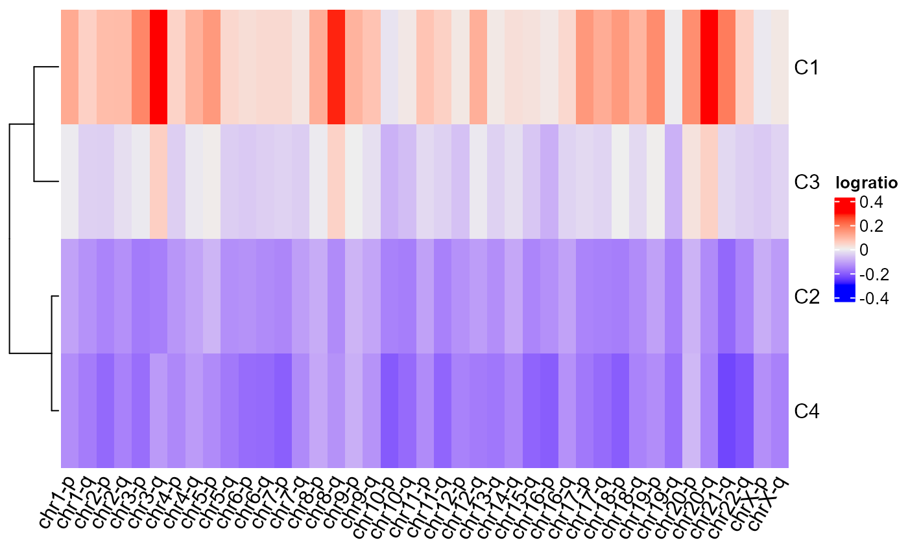
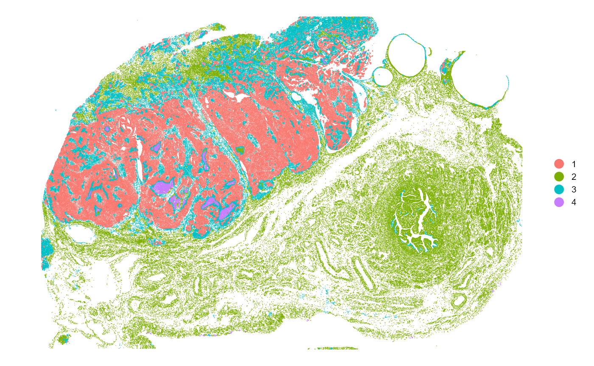
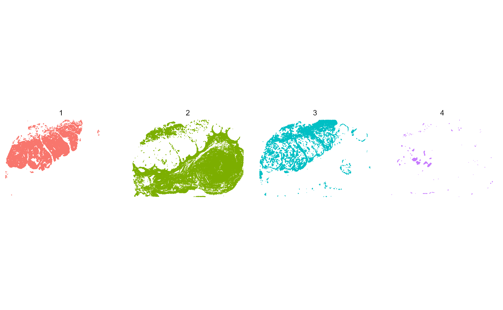

# Quick start

## Minimum workflow

SpatialCopyInference infers somatic copy number aberrations (SCNAs)
directly from Xenium spatial transcriptomics data. This vignette
demonstrates the minimum SpatialCopyInference workflow to compute
SCNA-defined spatial clusters using a human ovarian cancer dataset as an
example. An extended workflow is also available in the
[SpatialCopyInference workflow](SpatialCopyInference_workflow.md).

To reproduce this example, first download the Xenium output files from:
<https://www.10xgenomics.com/datasets/xenium-prime-ffpe-human-ovarian-cancer>

``` r

# Path to Xenium output directory
data_dir <- "path/to/Xenium_outputs/outs"

# Path to refined cell type annotations
annotation_file <- "path/to/cell_type_annotations.csv"
```

``` r

# Load SpatialCopyInference
library(SpatialCopyInference)

# Import data
xenium.obj <- import_xenium(data_dir, annotation_file)

# Quality control
xenium.obj <- filter_cells(xenium.obj)
xenium.obj <- filter_genes(xenium.obj, min_cells = 50, min_counts = 50)

# Normalisation
xenium.obj <- normalise_data(xenium.obj)

# Compute chromosome arm means 
arm_means <- compute_arm_means(xenium.obj, min_genes_per_arm = 5)

# SCNA inference
arm_ratios <- compute_arm_ratios(arm_means, 
                                 xenium.obj,
                                 group_var = "group",
                                reference = c("Fallopian Tube Epithelium", "Secretory Epithelial Cells"))

# Spatial clustering
BANKSY.obj <- compute_spatial_clusters(arm_ratios = arm_ratios,
          xenium.obj = xenium.obj,
          lambda = 0.8,
          resolution = 0.1)
xenium.obj <- add_banksy_clusters(xenium.obj, BANKSY.obj)

# Visualisation
plot_cluster_heatmaps(BANKSY.obj, resolutions = 0.1)
#> $res_0.1
```



``` r

plot_spatial_clusters(xenium.obj)
#> $spatial_clusters_plot
```



    #> 
    #> $spatial_clusters_plot_facets


