# SpatialCopyInference workflow

## Introduction

SpatialCopyInference infers somatic copy number aberrations (SCNAs)
directly from Xenium spatial transcriptomics data. This vignette
demonstrates the complete SpatialCopyInference workflow using a human
ovarian cancer dataset as an example.

First, packages necessary for this vignette are loaded.

``` r

# Load SpatialCopyInference
library(SpatialCopyInference)

# Load additional packages used in this workflow
library(ggplot2)
library(patchwork)
library(dplyr)
```

## Data import

This workflow uses a Xenium human ovarian cancer dataset from 10x
Genomics: FFPE Human Ovarian Cancer with the 5K Human Pan Tissue and
Pathways Panel plus 100 custom genes.

Users wishing to reproduce this analysis should first download the
Xenium output files from:

<https://www.10xgenomics.com/datasets/xenium-prime-ffpe-human-ovarian-cancer>

Matched single-cell Gene Expression Flex data were used for cell type
annotation: Human Ovarian Cancer FFPE Single Cell Gene Expression Flex.

<https://www.10xgenomics.com/datasets/17k-human-ovarian-cancer-scFFPE>

Cell type annotations were generated using the 10x Genomics label
transfer workflow and subsequently refined through manual curation.

<https://www.10xgenomics.com/analysis-guides/xenium-cell-type-annotation>

The Xenium data and accompanying cell type annotations are imported
using [`import_xenium()`](../reference/import_xenium.md). This function
loads Xenium output files into a Seurat object and optionally adds cell
type annotations from a CSV file.

``` r

# Path to Xenium output directory
data_dir <- "path/to/Xenium_outputs/outs"

# Path to refined cell type annotations
annotation_file <- "path/to/cell_type_annotations.csv"
```

``` r

# Import Xenium data
xenium.obj <- import_xenium(data_dir, annotation_file)

# Dataset dimensions
dim(xenium.obj)
#> [1]   5101 407124

# Check if any unannotated cells
sum(is.na(xenium.obj$group))
#> [1] 513
```

## Quality control

Cell quality is assessed using the distributions of detected genes
(`nFeature_Xenium`) and transcript counts (`nCount_Xenium`).

``` r

# Calculate quantiles for genes and counts
probs <- c(0.01, 0.02, 0.05, 0.1, 0.25, 0.5, 0.75)

feature_quantiles <- data.frame(
  quantile = names(quantile(xenium.obj$nFeature_Xenium, probs)),
  features = as.numeric(quantile(xenium.obj$nFeature_Xenium, probs))
)

count_quantiles <- data.frame(
  quantile = names(quantile(xenium.obj$nCount_Xenium, probs)),
  counts = as.numeric(quantile(xenium.obj$nCount_Xenium, probs))
)

features_df <- data.frame(nFeature_Xenium = xenium.obj$nFeature_Xenium)
counts_df <- data.frame(nCount_Xenium = xenium.obj$nCount_Xenium)

# Plot distribution info on top of Violin plots using ggplot2
# add + 1 to counts for log scale visualisation
Vln_features <- ggplot(features_df, aes(x = "", y = nFeature_Xenium + 1)) +
                          geom_violin(fill = "salmon", colour = "black", linewidth = 0.3) +
                          geom_boxplot(width = 0.08, outlier.shape = NA, linewidth = 0.3) +
                          geom_hline(yintercept = feature_quantiles$features + 1,
                                      linetype = "dashed", linewidth = 0.4) +
                          geom_text(data = feature_quantiles, 
                                    aes(x = Inf, y = features + 1,label = paste0(quantile, "(",features + 1,")")), 
                                    inherit.aes = FALSE, hjust = 1.1, vjust = -0.4, size = 3.5) +
                          scale_y_log10() +
                          annotation_logticks(sides = "l") +
                          labs(y = "nFeature_Xenium + 1", x = NULL, title = "nFeature_Xenium")+
                          theme_classic() 

Vln_counts <- ggplot(counts_df, aes(x = "", y = nCount_Xenium + 1)) +
                        geom_violin(fill = "salmon", colour = "black", linewidth = 0.3) +
                        geom_boxplot(width = 0.08, outlier.shape = NA, linewidth = 0.3) +
                        geom_hline(yintercept = count_quantiles$counts + 1,
                                   linetype = "dashed", linewidth = 0.4) +
                        geom_text(data = count_quantiles, 
                                  aes(x = Inf, y = counts + 1,label = paste0(quantile, "(",counts + 1,")")), 
                                  inherit.aes = FALSE, hjust = 1.1, vjust = -0.4, size = 3.5) +
                        scale_y_log10() +
                        annotation_logticks(sides = "l") +
                        labs(y = "nCount_Xenium + 1", x = NULL, title = "nCount_Xenium")+
                        theme_classic() 

print(Vln_features | Vln_counts)
```


Based on these distributions, low quality cells are removed using
[`filter_cells()`](../reference/filter_cells.md).

``` r

# Dataset dimensions before filtering
dim(xenium.obj)
#> [1]   5101 407124

# Filter low quality cells
xenium.obj <- filter_cells(xenium.obj)

# Dataset dimensions after filtering
dim(xenium.obj)
#> [1]   5101 398993
```

## Gene filtering

Lowly expressed genes are filtered using
[`filter_genes()`](../reference/filter_genes.md) prior to downstream
analyses.

``` r

# Number of genes before filtering
nrow(xenium.obj)
#> [1] 5101

# Filter lowly expressed genes
xenium.obj <- filter_genes(xenium.obj,
                              min_cells = 50,
                              min_counts = 50)

# Number of genes after filtering
nrow(xenium.obj)
#> [1] 5090

# Display removed genes
head(xenium.obj@misc$removed_genes, 20)
#>  [1] "CYP2A6"                  "EIF1AY"                 
#>  [3] "F2"                      "HPV16-E6"               
#>  [5] "HPV16-E7"                "HPV18-E6"               
#>  [7] "Human-CTNNB1-S33C-ALT:G" "Human-FGFR3-R248H-ALT:A"
#>  [9] "Human-FGFR3-R248H-WT:A"  "Human-PTEN-G129E-WT:A"  
#> [11] "SRY"
```

## Visualise cells

After quality control, annotated cells are visualised using
[`plot_cells()`](../reference/plot_cells.md).

``` r

# Plot annotated cells
plot_cells(xenium.obj)
```


## Normalisation

Normalisation is performed using
[`normalise_data()`](../reference/normalise_data.md), which applies
[`Seurat::NormalizeData()`](https://satijalab.org/seurat/reference/NormalizeData.html)
with the “LogNormalize” method and converts the resulting values to log2
scale.

``` r

# Perform normalisation
xenium.obj <- normalise_data(xenium.obj)

# Example log2-normalised expression values for selected genes
xenium.obj@assays$Xenium$data[c("CCNE1", "MKI67", "TP53"), 1:5]
#> 3 x 5 sparse Matrix of class "dgCMatrix"
#>       aaaaebmm-1 aaaafhpp-1 aaaahcem-1 aaaakeoi-1 aaaalald-1
#> CCNE1   .                 .   5.096877          .   .       
#> MKI67   .                 .   .                 .   5.125085
#> TP53    5.087603          .   5.096877          .   .
```

## Positional information

The package includes pre-computed hg38 positional information for genes,
chromosomes and chromosome arms. These resources were generated using
[`get_genomic_info()`](../reference/get_genomic_info.md) and
[`create_hg38_annotation()`](../reference/create_hg38_annotation.md) and
can be regenerated if required.

`hg38_gene_info` contains gene level positional information, while
`hg38_chrom_info` contains chromosome and centromere coordinates used
throughout SpatialCopyInference analyses.

## Chromosome arm means

Chromosome arm means for each cell are computed using
[`compute_arm_means()`](../reference/compute_arm_means.md), which
aggregates gene expression values within each chromosome arm and
calculates the mean expression. This summarises expression at the
chromosome arm level, which is the basis for subsequent copy number
inference. The minimum number of genes required per chromosome arm can
be specified.

``` r

# Compute arm means 
arm_means_matrix <- compute_arm_means(xenium.obj,
                                      min_genes_per_arm = 5)

# Show values for a subset chromosome arms and cells
arm_means_matrix[1:5, 1:5]
#>        aaaaebmm-1 aaaafhpp-1 aaaahcem-1 aaaakeoi-1 aaaalald-1
#> chr1_p  0.3377456  0.2075805  0.1570955  0.3416053  0.3577399
#> chr1_q  0.2174228  0.2243669  0.1656896  0.2330327  0.3660775
#> chr2_p  0.1884297  0.2338484  0.2359665  0.2408403  0.1898180
#> chr2_q  0.1695868  0.3413992  0.2520300  0.3254727  0.3340076
#> chr3_p  0.2898429  0.4938419  0.3832238  0.4893765  0.1541379
```

## Reference selection

Reference profiles used for somatic copy number inference are computed
using [`compute_reference()`](../reference/compute_reference.md).
Reference profiles can be generated from all cells, multiple selected
cell populations combined or individual cell populations.

In this ovarian cancer dataset, we compare the default reference
generated from all cells with a reference derived from the normal
epithelial populations *Fallopian Tube Epithelium* and *Secretory
Epithelial Cells*, which include the cell types of origin thought to
give rise to high-grade serous ovarian cancer (HGSOC). Normal diploid
reference populations are preferred because they are less likely to
harbour SCNAs and therefore provide a more stable baseline for copy
number inference. When a suitable diploid reference population is
unavailable, the global mean across all cells can be used instead.

A detailed comparison of chromosome arm mean expression profiles across
annotated cell populations is available on the companion website under
[Cell type
means](https://florishonig.github.io/SpatialCopyInference-paper/Cell_type_means.html).

``` r

# Global reference (default)
global_ref_arm_means <- compute_reference(
  xenium.obj
  )

global_ref_arm_means$group <- "All Cells"

# Combined epithelial reference
epithelium_ref_arm_means <- compute_reference(
  xenium.obj,
  group_var = "group",
  group_names = c("Fallopian Tube Epithelium", "Secretory Epithelial Cells")
  )

epithelium_ref_arm_means$group <- "Epithelium"

# Fallopian Tube Epithelium
ft_ref_arm_means <- compute_reference(
  xenium.obj,
  group_var = "group",
  group_names = "Fallopian Tube Epithelium")

ft_ref_arm_means$group <- "Fallopian Tube Epithelium"

# Secretory Epithelial Cells
secretory_ref_arm_means <- compute_reference(
  xenium.obj,
  group_var = "group",
  group_names = "Secretory Epithelial Cells")

secretory_ref_arm_means$group <- "Secretory Epithelial Cells"

# Proliferative Tumour Cells (comparison only)
tumour_ref_arm_means <- compute_reference(
  xenium.obj,
  group_var = "group",
  group_names = "Proliferative Tumour Cells")

tumour_ref_arm_means$group <- "Proliferative Tumour Cells"
```

The reference profiles are compared below alongside representative
normal and tumour cell populations.

``` r

arm_means_to_plot <- dplyr::bind_rows(
  global_ref_arm_means,
  epithelium_ref_arm_means,
  ft_ref_arm_means,
  secretory_ref_arm_means,
  tumour_ref_arm_means)

# Plot profiles
ggplot() +
  geom_vline(
    xintercept = hg38_chrom_info$cum_centromere_mid,
    linetype = "dashed",
    linewidth = 0.3
  ) +
  geom_vline(
    xintercept = hg38_chrom_info$cum_length,
    linewidth = 0.3
  ) +
  geom_segment(
    data = dplyr::filter(
      arm_means_to_plot,
      arm == "p"
    ),
    aes(
      x = p_start,
      xend = p_end,
      y = mean_arm_expr,
      colour = group
    ),
    linewidth = 0.8,
    linetype = "11"
  ) +
  geom_segment(
    data = dplyr::filter(
      arm_means_to_plot,
      arm == "q"
    ),
    aes(
      x = q_start,
      xend = q_end,
      y = mean_arm_expr,
      colour = group
    ),
    linewidth = 0.8,
    linetype = "11"
  ) +
  scale_colour_manual(
    values = c(
      "Proliferative Tumour Cells" = "#F1CE63",
      "Epithelium" = "purple",
      "Fallopian Tube Epithelium" = "#59A14F",
      "Secretory Epithelial Cells" = "#F28E2B",
      "All Cells" = "black"
    )
  ) +
  scale_x_continuous(
    breaks = hg38_chrom_info$cum_chromosome_mid,
    labels = hg38_chrom_info$chrom,
    expand = c(0, 0)
  ) +
  theme_classic() +
  theme(
    axis.text.x = element_text(
      colour = "black",
      size = 8,
      angle = 50,
      hjust = 1
    ),
    axis.text.y = element_text(
      colour = "black",
      size = 9
    ),
    axis.title.x = element_text(
      colour = "black",
      size = 8
    ),
    axis.title.y = element_text(
      colour = "black",
      size = 8
    ),
    legend.text = element_text(
      colour = "black",
      size = 8
    ),
    legend.position = "right",
    legend.title = element_blank()
  ) +
  ylim(0, 1) +
  labs(
    x = "Chromosome",
    y = "Log-normalised expression",
    title = "Reference comparison"
  )
```


## Example cell profiles

Example cell profiles can be visualised using
[`plot_cell_profiles()`](../reference/plot_cell_profiles.md). Below,
representative normal and tumour cells are shown using the epithelial
reference profile. Note the distinct deviations from the reference.

- Fallopian Tube Epithelium
- Ciliated Epithelial Cell
- Tumour Cell
- Proliferative Tumour Cell

``` r

plot_cell_profiles(xenium.obj = xenium.obj,
    cell_id = "aamfeehk-1",  # Fallopian Tube Epithelium
    arm_means_matrix = arm_means_matrix,
    reference = epithelium_ref_arm_means)
```

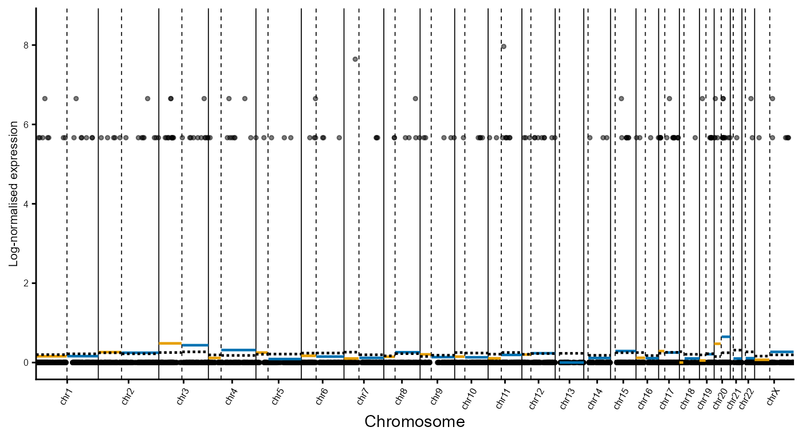

``` r

plot_cell_profiles(xenium.obj = xenium.obj,
    cell_id = "aabgmdld-1",  # Ciliated Epithelial Cell
    arm_means_matrix = arm_means_matrix,
    reference = epithelium_ref_arm_means)
```

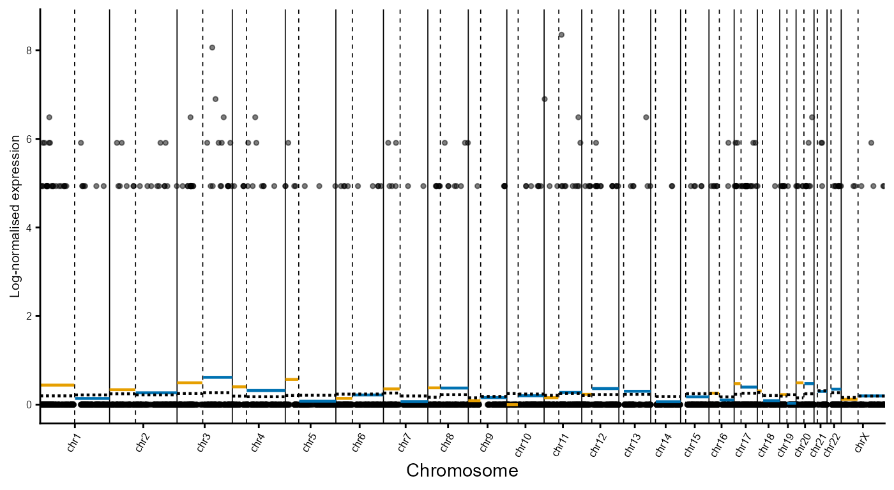

``` r

plot_cell_profiles(xenium.obj = xenium.obj,
    cell_id = "aaajknem-1",  # Tumour Cell
    arm_means_matrix = arm_means_matrix,
    reference = epithelium_ref_arm_means)
```

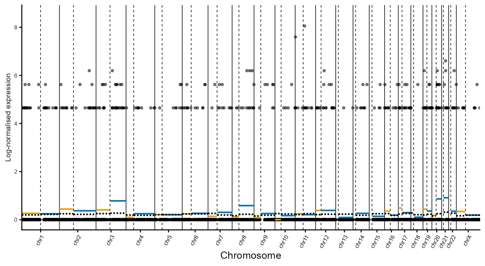

``` r

plot_cell_profiles(xenium.obj = xenium.obj,
    cell_id = "aaabianm-1",  # Proliferative Tumour Cell
    arm_means_matrix = arm_means_matrix,
    reference = epithelium_ref_arm_means)
```

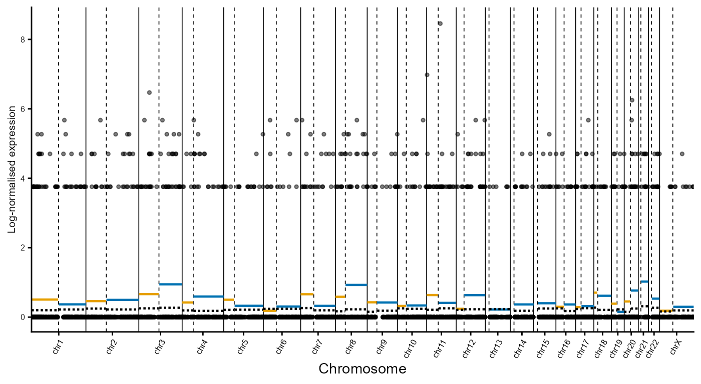

## Log ratio profiles

Somatic copy number inference is performed by comparing chromosome arm
mean expression levels against the chosen reference profile. Here,
chromosome arm log ratios are computed using the epithelial reference
with [`compute_arm_ratios()`](../reference/compute_arm_ratios.md). In
this example, the epithelial reference is defined as the combination of
*Fallopian Tube Epithelium* and *Secretory Epithelial Cells* cell
populations specified via the `reference` argument.

``` r

# Compute chromosome arm ratios using Epithelium as reference
arm_ratios <- compute_arm_ratios(arm_means_matrix,
    xenium.obj,
     group_var = "group",
    reference = c("Fallopian Tube Epithelium", "Secretory Epithelial Cells")
    )

# Show ratios for a subset chromosome arms and cells
arm_ratios[1:5, 1:5]
#>          aaaaebmm-1   aaaafhpp-1   aaaahcem-1   aaaakeoi-1  aaaalald-1
#> chr1_p  0.139009573  0.008844501 -0.041640487  0.142869336  0.15900393
#> chr1_q -0.002075896  0.004868228 -0.053809067  0.013534031  0.14657882
#> chr2_p -0.057486228 -0.012067545 -0.009949432 -0.005075618 -0.05609800
#> chr2_q -0.050588558  0.121223913  0.031854697  0.105297385  0.11383231
#> chr3_p  0.037109571  0.241108619  0.130490515  0.236643205 -0.09859543
```

``` r

# Save processed Xenium object for downstream analyses
saveRDS(arm_ratios,
  file = "arm_ratios_ovarian.rds")
```

## Example log ratio profiles

Example log ratio cell profiles can be visualised using
[`plot_cell_log_ratios()`](../reference/plot_cell_log_ratios.md). Below,
representative normal and tumour cells are shown using the epithelial
reference profile.

- Fallopian Tube Epithelium
- Ciliated Epithelial Cell
- Tumour Cell
- Proliferative Tumour Cell

``` r

plot_cell_log_ratios(xenium.obj = xenium.obj,
    cell_id = "aamfeehk-1",  # Fallopian Tube Epithelium
    arm_ratios = arm_ratios,
    reference_groups = c("Fallopian Tube Epithelium", "Secretory Epithelial Cells")
    ) 
```

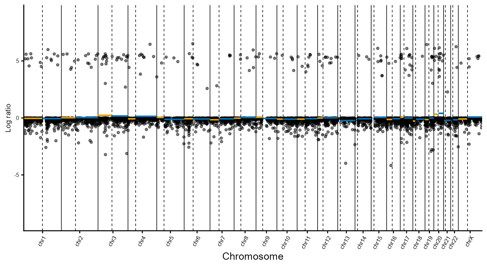

``` r

plot_cell_log_ratios(xenium.obj = xenium.obj,
    cell_id = "aabgmdld-1",  # Ciliated Epithelial Cell
    arm_ratios = arm_ratios,
    reference_groups = c("Fallopian Tube Epithelium", "Secretory Epithelial Cells")
    ) 
```

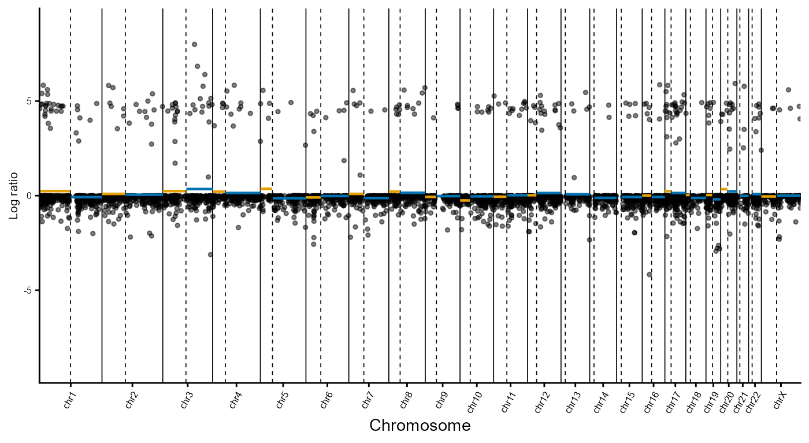

``` r

plot_cell_log_ratios(xenium.obj = xenium.obj,
    cell_id = "aaajknem-1",  # Tumour Cell
    arm_ratios = arm_ratios,
    reference_groups = c("Fallopian Tube Epithelium", "Secretory Epithelial Cells")
    )
```

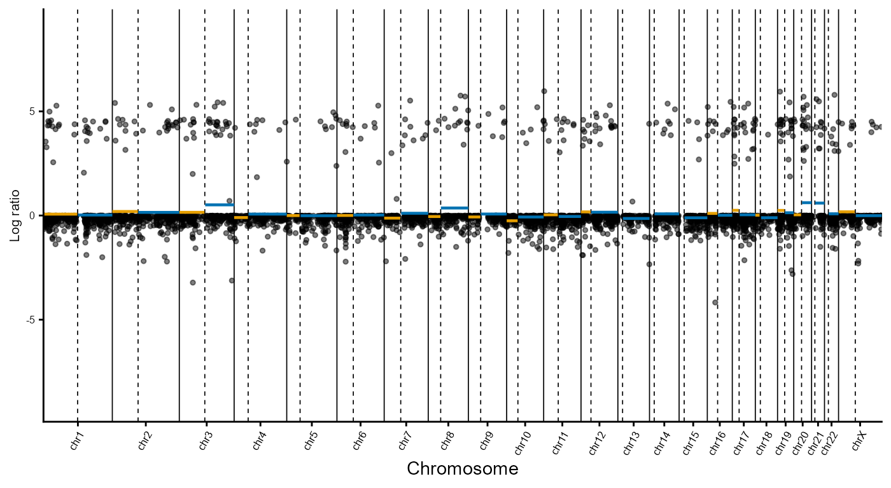

``` r

plot_cell_log_ratios(xenium.obj = xenium.obj,
    cell_id = "aaabianm-1",  # Proliferative Tumour Cell
    arm_ratios = arm_ratios,
    reference_groups = c("Fallopian Tube Epithelium", "Secretory Epithelial Cells")
    )
```

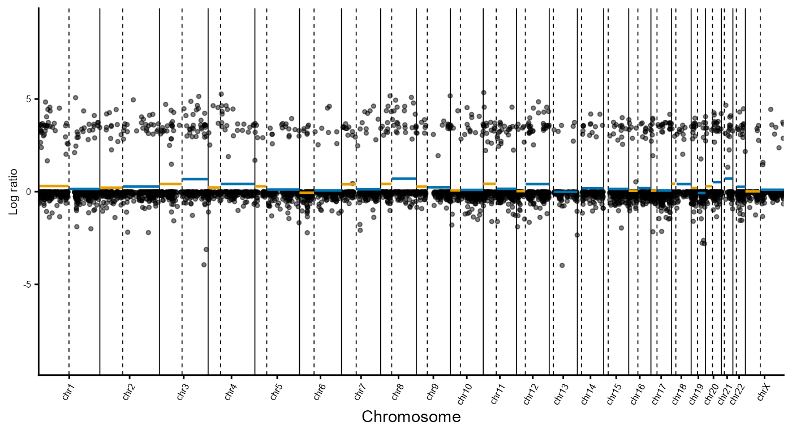

## Inferred SCNAs by cell type

Chromosome arm-level SCNAs can be visualised as a clustered heatmap
using `plot_ratio_heatmap`. This identifies recurrent chromosome
arm-level SCNAs in tumour-associated cell populations, whereas
non-malignant populations remain largely copy number neutral.

``` r

plot_ratio_heatmap(
    xenium.obj,
    reference_group = c("Fallopian Tube Epithelium","Secretory Epithelial Cells")
)
```


## Spatial clustering

Spatial clustering is performed to incorporate spatial context into SCNA
inference, based on the assumption that neighbouring cells are more
likely to share common evolutionary trajectories.

Spatial clustering is implemented using BANKSY\*, which integrates
neighbourhood composition and local spatial structure to identify
spatially coherent cell populations:

\*Singhal, V., Chou, N., Lee, J. et al. BANKSY unifies cell typing and
tissue domain segmentation for scalable spatial omics data analysis. Nat
Genet 56, 431–441 (2024). <https://doi.org/10.1038/s41588-024-01664-3>

Here, BANKSY is applied to chromosome arm log ratio profiles generated
by [`compute_arm_ratios()`](../reference/compute_arm_ratios.md) using
[`compute_spatial_clusters()`](../reference/compute_spatial_clusters.md).
The parameter `lambda` controls the contribution of spatial information,
while `resolution` controls cluster granularity. Optimal values are
dataset dependent and may require tuning by the user.

A detailed comparison of clustering parameters for the ovarian cancer
dataset is available on the companion website under [Cluster parameter
optimisation](https://florishonig.github.io/SpatialCopyInference-paper/Clustering_parameter_optimisation.html).

``` r

# BANKSY clustering using lambda = 0.8
BANKSY.obj <- compute_spatial_clusters(
          arm_ratios = arm_ratios,
          xenium.obj = xenium.obj,
          lambda = 0.8,
          resolution = c(0.1)
          )
```

## Cluster visualisation

The resulting clusters can be visualised using
[`plot_cluster_heatmaps()`](../reference/plot_cluster_heatmaps.md).
Multiple resolutions can be evaluated simultaneously when optimising
clustering parameters. In this ovarian cancer dataset, the identified
clusters exhibit distinct chromosome arm-level SCNA profiles, resolving
tumour, non-malignant and intermediate populations.

Validation of inferred chromosome arm level SCNAs, including recurrent
chr3q and chr8q gains, against SCNAs observed in TCGA Ovarian Serous
Cystadenocarcinoma is available on the companion website under
[TCGA](https://florishonig.github.io/SpatialCopyInference-paper/TCGA.html).

``` r

# Plot cluster heatmap for lambda = 0.8 and resolution = 0.1
heatmap <- plot_cluster_heatmaps(
            BANKSY.obj,
            resolutions = c(0.1)
            )
heatmap$res_0.1
```


Cluster assignments can then be transferred back to the Xenium object
using [`add_banksy_clusters()`](../reference/add_banksy_clusters.md).

``` r

# Add arm clusters of desired lambda and resolution back to main Xenium object
xenium.obj <- add_banksy_clusters(xenium.obj,
              BANKSY.obj,
              resolution = 0.1)
```

Spatial cluster assignments can be visualised using
[`plot_spatial_clusters()`](../reference/plot_spatial_clusters.md).

``` r

# Custom colour pallete
col_pal_BANKSY <- c("1"="#8CD17D","2"="#F28E2B","3"="#4E79A7","4"="#F1CE63")

# Plot spatial clusters
plots <- plot_spatial_clusters(
    xenium.obj, 
    cluster_palette = col_pal_BANKSY
    )

# Plot one image with all spatial clusters
plots$spatial_clusters_plot
```


``` r


# Plot each spatial cluster separately
plots$spatial_clusters_plot_facets
```


The composition of cell groups across BANKSY-derived spatial clusters is
visualised using
[`plot_cluster_composition()`](../reference/plot_cluster_composition.md).
For each cell group, the proportion of cells assigned to each spatial
cluster is displayed as a stacked bar plot. Cell groups are ordered by
their dominant spatial cluster to facilitate comparison of cluster
composition patterns.

``` r

# Custom colour palette
col_pal_BANKSY <- c("#8CD17D","#F28E2B","#4E79A7","#F1CE63")

# Plot cluster composition with custom palette
plot_cluster_composition(xenium.obj,
    cluster_palette = col_pal_BANKSY
    )
```


## Spatial cluster annotation

Annotated cell types within spatial clusters are plotted using
`plot_cluster_annotated`. Here, `manual_col` and `legend_order` are used
to define a custom colour scheme and legend order for the cell type
annotations.

- `# Set manual colours from palette`` ``manual_col`` ``<-`` `[`c`](https://rdrr.io/r/base/c.html)`(``"Proliferative Tumour Cells"`` ``=`` ``"#F1CE63"``,`` `` ``"MT-High, Jun+/Fos+ Tumour Cells"`` ``=`` ``"#86BCB6"``,`` `` ``"VEGFA+ Tumour Cells"`` ``=`` ``"#FABFD2"``,`` `` ``"Tumour Cells"`` ``=`` ``"#D37295"``,`` `` ``"Fallopian Tube Epithelium"`` ``=`` ``"#59A14F"``,`` `` ``"Macrophages"`` ``=`` ``"#8CD17D"``,`` `` ``"Tumour Associated Ciliated Epithelial Cells"`` ``=`` ``"#A0CBE8"``,`` `` ``"Ciliated Epithelial Cells"`` ``=`` ``"#4E79A7"``,`` `` ``"T & NK Cells"`` ``=`` ``"#79706E"``,`` `` ``"Tumour Associated Fibroblasts"`` ``=`` ``"#BAB0AC"``,`` `` ``"Malignant Cells Lining Cyst"`` ``=`` ``"#B6992D"``,`` `` ``"Endothelial Cells"`` ``=`` ``"#D7B5A6"``,`` `` ``"Stromal Associated Fibroblasts"`` ``=`` ``"#FF9D9A"``,`` `` ``"Pericytes"`` ``=`` ``"#499894"``,`` `` ``"Smooth Muscle Cells"`` ``=`` ``"#E15759"``,`` `` ``"Inflammatory Tumour Cells"`` ``=`` ``"#B07AA1"``,`` `` ``"Granulosa Cells"`` ``=`` ``"#FFBE7D"``,`` `` ``"Secretory Epithelial Cells"`` ``=`` ``"#F28E2B"``)`` `` ``# Add legend order`` ``legend_order`` ``<-`` `[`c`](https://rdrr.io/r/base/c.html)`(``"Tumour Cells"``, ``"Inflammatory Tumour Cells"``, ``"Proliferative Tumour Cells"``, ``"VEGFA+ Tumour Cells"``, ``"MT-High, Jun+/Fos+ Tumour Cells"``, ``"Malignant Cells Lining Cyst"``, ``"Tumour Associated Fibroblasts"``, ``"Tumour Associated Ciliated Epithelial Cells"``, ``"Fallopian Tube Epithelium"``, ``"Secretory Epithelial Cells"``, ``"Ciliated Epithelial Cells"``, ``"Granulosa Cells"``,``"Endothelial Cells"``, ``"Pericytes"``, ``"Stromal Associated Fibroblasts"``, ``"Smooth Muscle Cells"``, ``"Macrophages"``, ``"T & NK Cells"``)`
- Cluster 1
- Cluster 2
- Cluster 3
- Cluster 4

``` r

plot_cluster_annotated(
    xenium.obj = xenium.obj,
    cluster_id = 1,
    group_palette = manual_col,
    legend_order = legend_order) +
  theme(legend.position = "right")
```

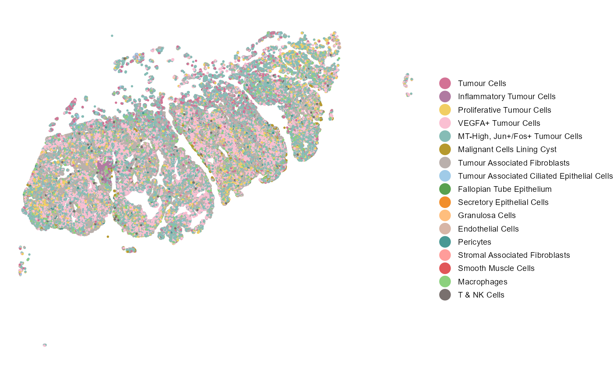

``` r

plot_cluster_annotated(
    xenium.obj = xenium.obj,
    cluster_id = 2,
    group_palette = manual_col,
    legend_order = legend_order) +
    theme(legend.position = "right")
```

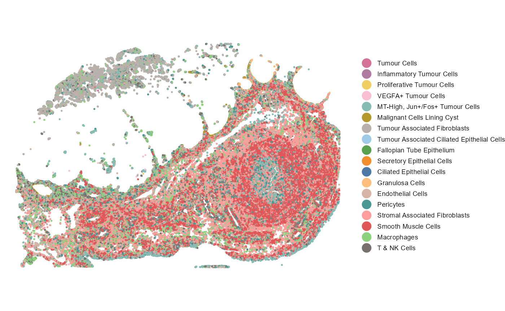

``` r

plot_cluster_annotated(
    xenium.obj = xenium.obj,
    cluster_id = 3,
    group_palette = manual_col,
    legend_order = legend_order) +
    theme(legend.position = "right")
```

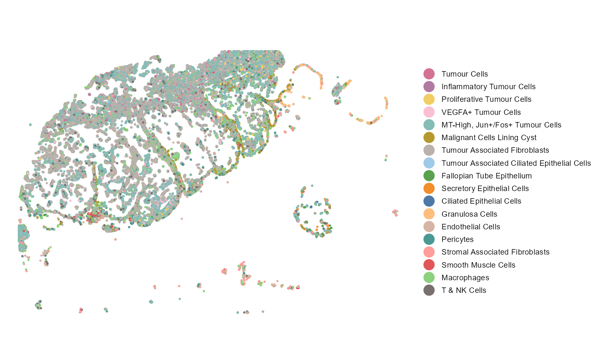

``` r

plot_cluster_annotated(
    xenium.obj = xenium.obj,
    cluster_id = 4,
    group_palette = manual_col,
    legend_order = legend_order) +
    theme(legend.position = "right")
```

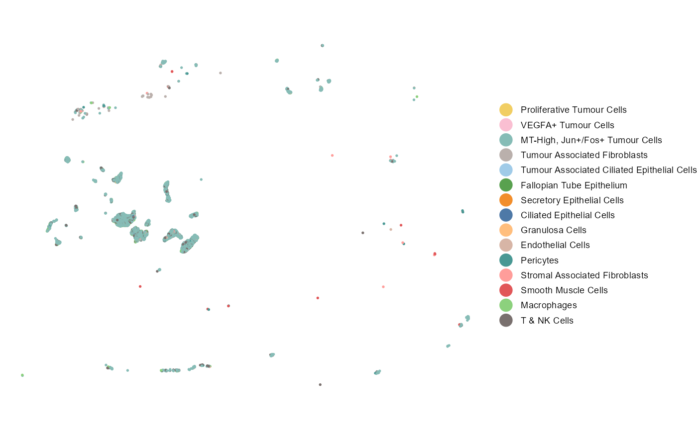

## Cluster comparison

Differential expression analyses identify genes associated with distinct
SCNA-defined cell populations across spatial clusters using
[`compare_spatial_clusters()`](../reference/compare_spatial_clusters.md).
This function performs differential expression testing and Gene Ontology
enrichment analysis between selected spatial clusters.

Genes are filtered using log-fold change and adjusted p-value thresholds
to identify up- and downregulated markers. Functional enrichment
analyses of significantly upregulated genes reveal biological processes
associated with each spatial cluster.

Below, Cluster 1 (tumour-associated) and Cluster 2 (non-malignant) are
compared as an example.

``` r

# Compare Cluster 1 vs 2
cluster1v2 <- compare_spatial_clusters(
              xenium.obj,
              ident_1 = "1",
              ident_2 = "2")

# Differentially expressed genes
head(cluster1v2$de)
#>         p_val avg_log2FC pct.1 pct.2 p_val_adj
#> H19         0  3.6709337 0.888 0.111         0
#> CD47        0  3.1226967 0.800 0.049         0
#> LAPTM4B     0  3.3033381 0.779 0.032         0
#> YWHAZ       0  1.2678262 0.752 0.083         0
#> NORAD       0  0.8549308 0.766 0.109         0
#> HNRNPD      0  0.7824252 0.782 0.126         0

# GO enrichment dot plot 
cluster1v2$go_dotplot
```


``` r

# GO enrichment cnet plot
cluster1v2$go_cnetplot
```

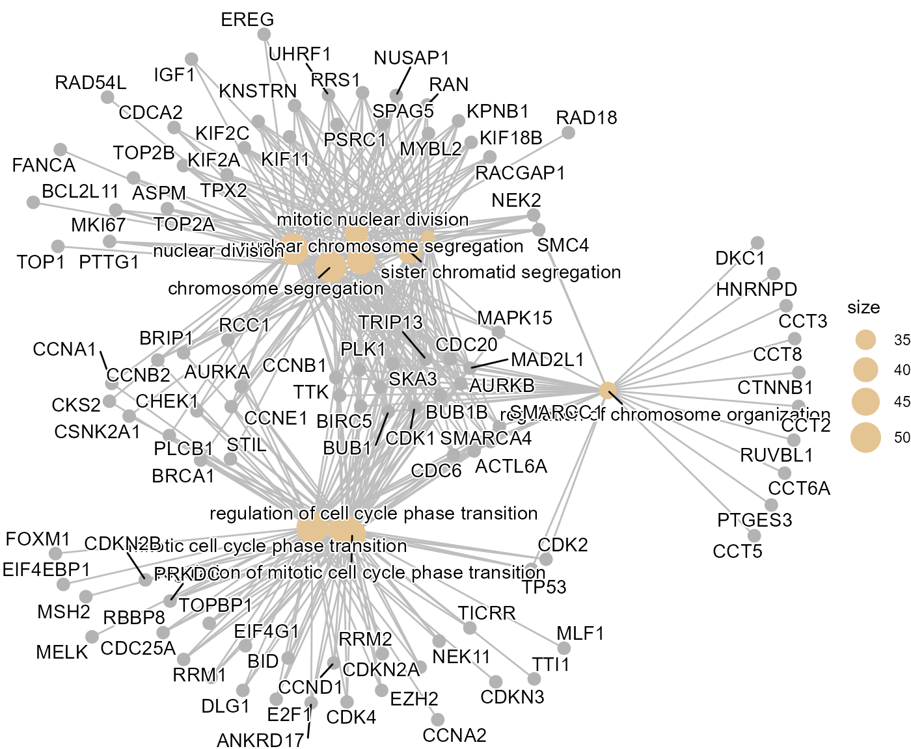

## Genomic hotspots

Differentially expressed genes are mapped across the genome using
[`plot_gene_density()`](../reference/plot_gene_density.md). Rather than
being randomly distributed, differentially expressed genes cluster
within specific genomic regions and form local hotspots associated with
the underlying inferred SCNAs.

Visualising these hotspots facilitates identification of candidate
driver genes and genomic regions that may contribute to cancer
progression.

``` r

# Custom driver genes
driver_genes <- c("MYC", "PIK3CA", "CCNE1", "KRAS", 
                  "TERT","AKT1", "AKT2", "AKT3", "CCND1", 
                  "CCND2", "CCND3", "KRAS", "MECOM")

# Plot gene density
plot_gene_density_obj <- plot_gene_density(
    de_results = cluster1v2$de,
    driver_genes = driver_genes,
    raised_driver_genes = c("MECOM","AKT2")
)
```


## Identification of key gene clusters

Differentially expressed genes are grouped into local genomic clusters
using
[`identify_gene_clusters()`](../reference/identify_gene_clusters.md).
Genes located within 2 Mb of one another are assigned to the same
cluster.

``` r

gene_clusters <- identify_gene_clusters(
    de_results = cluster1v2$de)
```

[`plot_gene_clusters()`](../reference/plot_gene_clusters.md) visualises
the genomic distribution of these clusters and can highlight known
driver genes within clustered regions. This facilitates interpretation
of the genomic regions underlying cluster-specific transcriptional
programmes. In this ovarian cancer dataset, several of the largest gene
clusters occur within chromosome arms showing recurrent gains in the
tumour population and overlap established HGSOC driver genes, including
MECOM, PIK3CA, MYC and CCND1.

``` r

# Plot gene clusters
plot_gene_clusters(gene_clusters = gene_clusters,
          driver_genes = driver_genes,
          raised_driver_genes = c("MECOM","AKT2")
          )
```


Chromosome-level visualisations are generated using
[`plot_gene_clusters_by_chromosome()`](../reference/plot_gene_clusters_by_chromosome.md).
Individual chromosomes can be explored in greater detail, with optional
overlays of genomic density signals and driver gene annotations.
Chromosome 3 is shown as an example below.

``` r

# Plot gene clusters chromosome 3
plot_gene_clusters_by_chromosome(
    gene_clusters = gene_clusters,
    chromosome = "chr3",
    density = plot_gene_density_obj$signal_gr,
    driver_genes = driver_genes,
    raised_driver_genes = c("MECOM", "AKT2")
    )
```


## Summary

This vignette demonstrated the complete SpatialCopyInference workflow
using a human ovarian cancer dataset, from data import, quality control,
normalisation, visualisation, SCNA inference, spatial clustering,
differential expression analyses and identification of genomic hotspots
and gene clusters associated with distinct spatial cell populations.

The same workflow can be applied to other Xenium datasets to identify
SCNA-defined cell populations to study early cancer development.

``` r

# Save processed Xenium object for downstream analyses
saveRDS(xenium.obj,
  file = "Xenium_ovarian.rds")
```

Example downstream analyses focusing on the intermediate cell population
within the histologically normal fallopian tube are available
[here](https://florishonig.github.io/SpatialCopyInference-paper/Normal_region_analyses.html).
